# arcade-cabinet

**2-player bartop arcade cabinet, designed for laser cutting, powered by a Raspberry Pi running Recalbox.**

  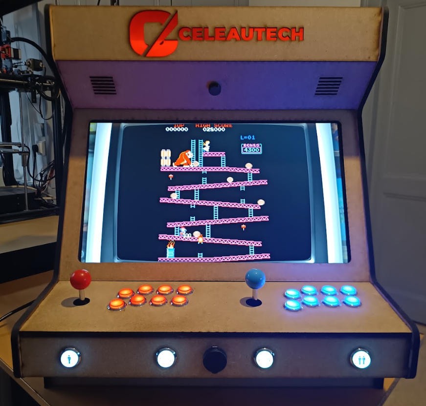

> **Who is this for?** This project is aimed at **experienced makers**. This README documents the key points, the pitfalls and the design choices, but it assumes **common sense and basic DIY skills** from the person following it: it is not a step-by-step tutorial for every screw. For the exact position of each part, refer to the **STEP assembly** in [`CAD/STEP/`](CAD/STEP/).

---

## Table of Contents

- [Overview](#overview)
- [Gallery](#gallery)
- [Specifications](#specifications)
- [Bill of Materials (BOM)](#bill-of-materials-bom)
- [Tools](#tools)
- [Manufacturing](#manufacturing)
- [Assembly](#assembly)
- [Electronics and Wiring](#electronics-and-wiring)
- [Controls](#controls)
- [Software: Recalbox](#software-recalbox)
- [Adding Games](#adding-games)
- [Coming Soon](#coming-soon)
- [License](#license)

---

## Overview

This project is a **bartop arcade cabinet** (designed to sit on a table) for **2 players**, with a **24" screen**.

- **Structure**: **laser-cut MDF** panels, assembled with **mortise and tenon joints**.
- **3D-printed parts**: a few small parts (back panel latches and lockers, volume knob).
- **Core**: a **Raspberry Pi** running [Recalbox](https://www.recalbox.com/), a ready-to-use emulation OS.
- **Controls**: a "Zero Delay" USB arcade kit, natively recognized by Recalbox, with no drivers to install.

The design is meant to be **reproducible by any maker** with access to a laser cutter and a 3D printer. All source files are provided.

---

## Gallery

### Real cabinet

| Powered on, front | Powered on, 3/4 | Powered off, 3/4 | Back |
| :---: | :---: | :---: | :---: |
|  | 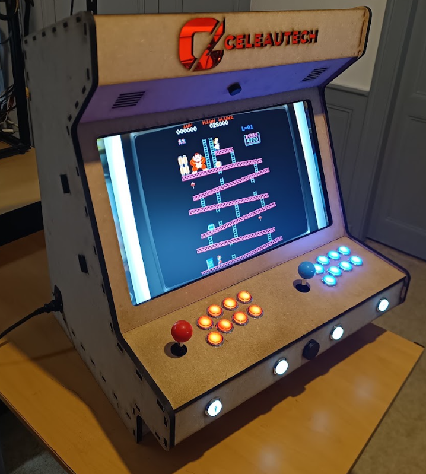 | 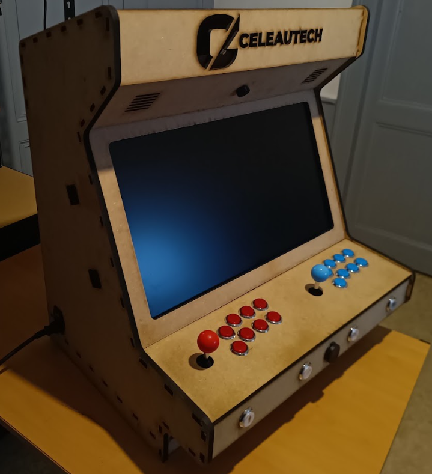 | 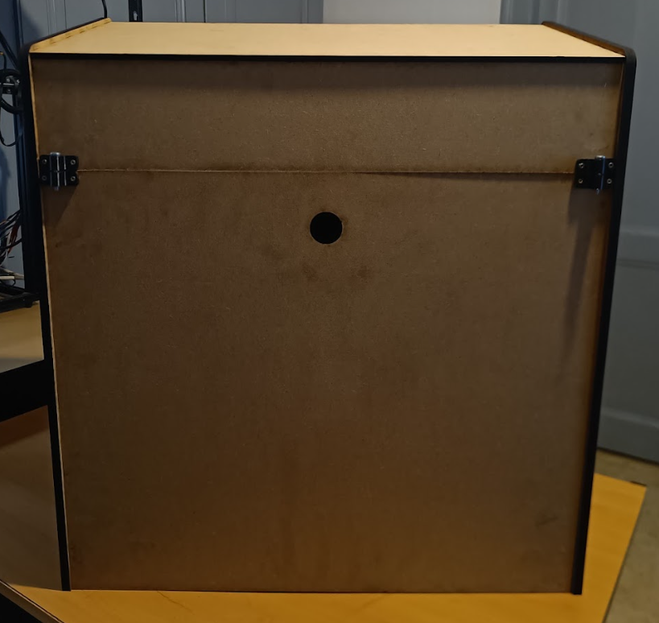 |

### CAD model

| Front | Left 3/4 | Right 3/4 |
| :---: | :---: | :---: |
| 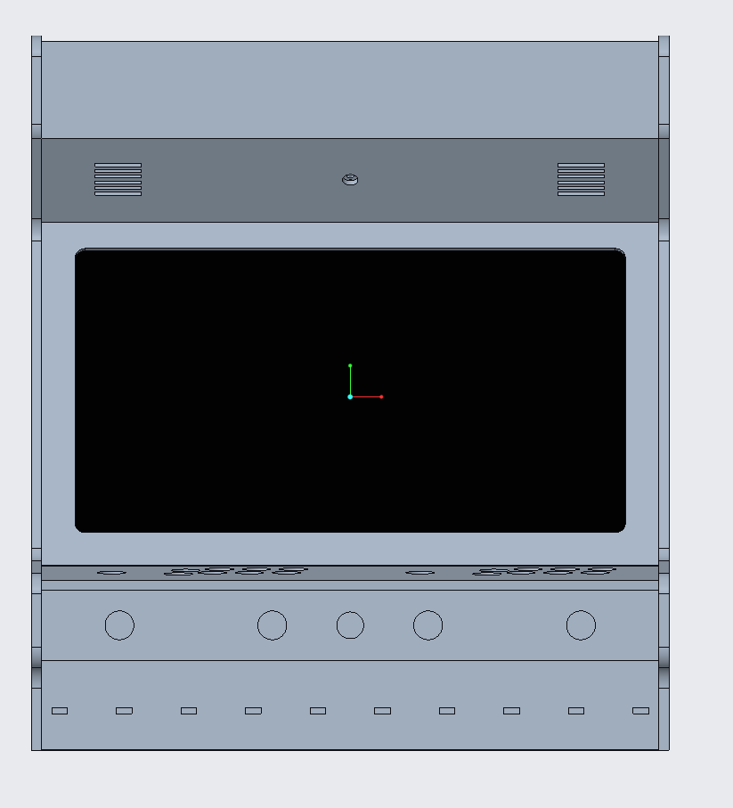 | 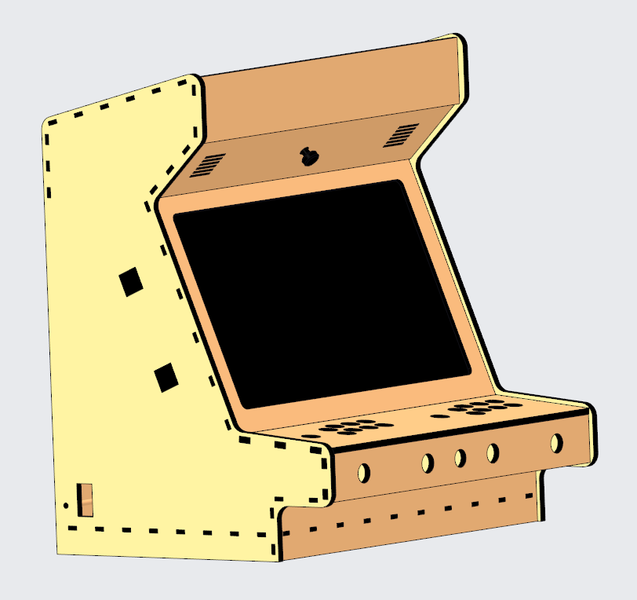 | 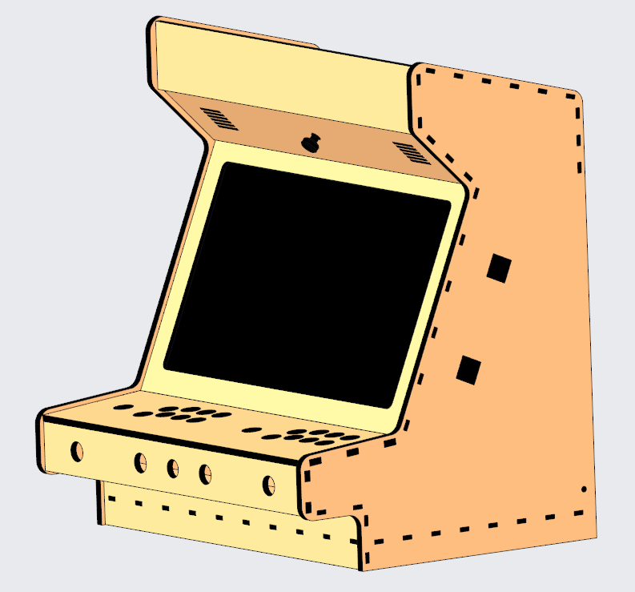 |

| Back with panel | Back without panel (screen position visible) | Side cut view |
| :---: | :---: | :---: |
| 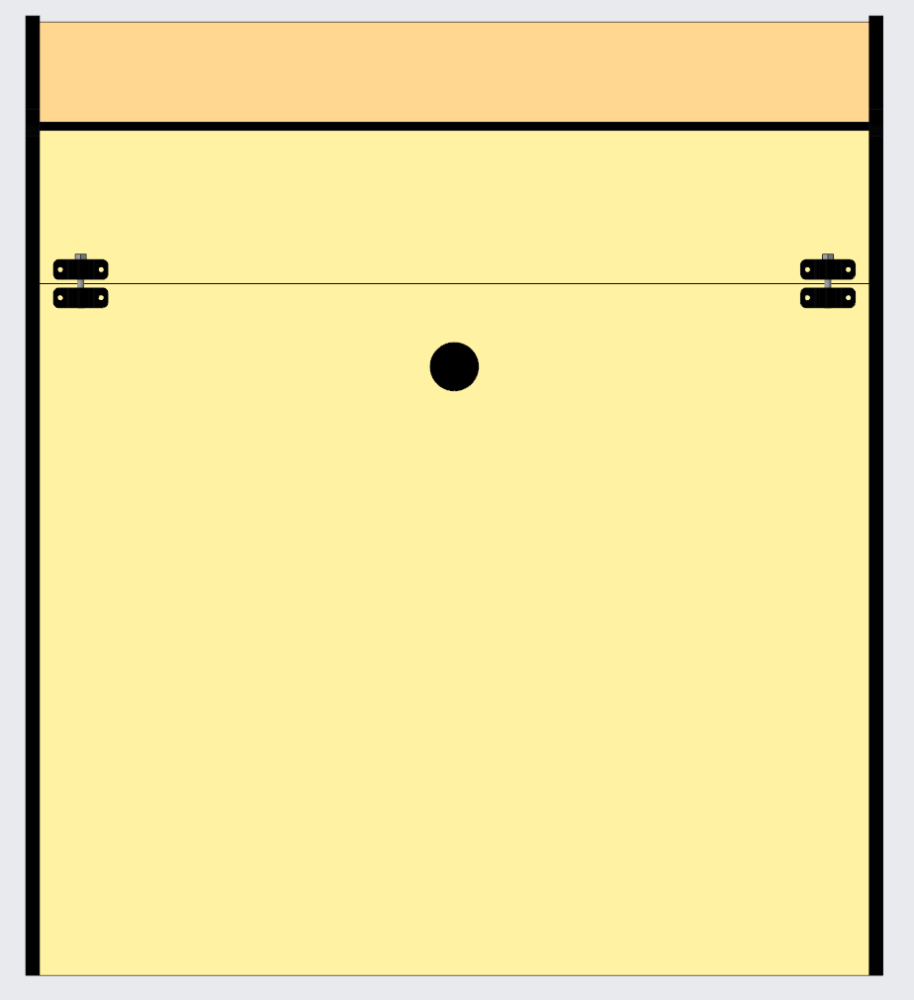 | 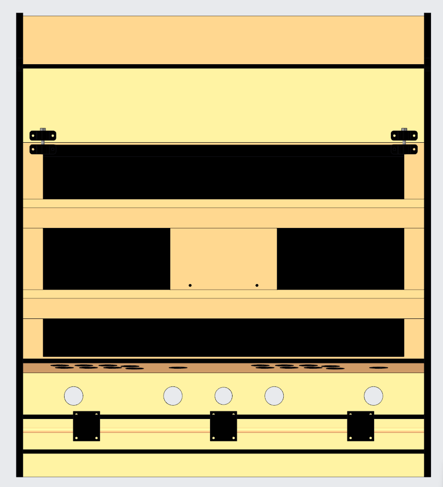 | 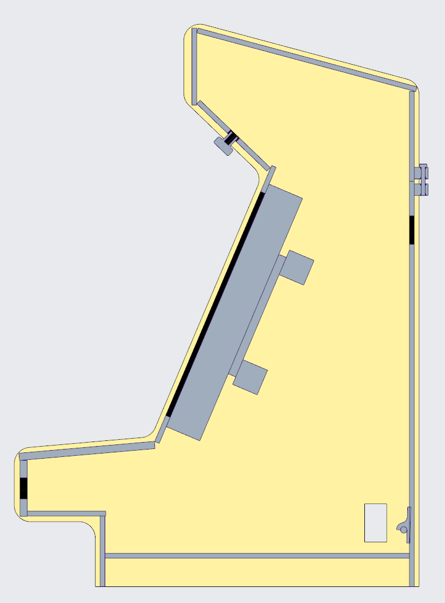 |

---

## Specifications

| Item | Detail |
| :--- | :--- |
| **Dimensions (W × D × H)** | 620 × ~500 × ~700 mm |
| **Screen** | 24" 16:9, VESA 100 × 100 mount |
| **Players** | 2 (+ 1 extra player possible via USB gamepad) |
| **Controls per player** | 1 eight-way joystick + 8 LED buttons |
| **Front panel** | 1P Start, 2P Start, 2 Coin buttons, USB pass-through port |
| **Audio** | 5 V stereo amplifier + 2 × 2" 4 Ω speakers, volume adjustable from the front |
| **Power** | 230 V IEC inlet with switch and fuse |
| **Material** | MDF 6 / 9 / 10 mm |
| **Software** | Recalbox (no customization required) |

---

## Bill of Materials (BOM)

The complete, detailed list is in **[BOM.md](BOM.md)**. It covers:

1. **Electronics**: Raspberry Pi, monitor, arcade kit, power supply, audio, etc.
2. **Hardware**: screws, battens, dowel, bracket.
3. **3D-printed parts**: 3 `.3mf` files.
4. **Laser-cut parts**: 14 `.dxf` files, with the MDF thickness for each.

> **Heads-up on arcade buttons**: buttons sold as "30 mm" actually have a **28 mm** threaded body. The DXF holes are cut at **Ø 28 mm** for a snug fit. **Do not enlarge them** without measuring your buttons with calipers first. See the [BOM](BOM.md) for details.

---

## Tools

### Machines used

| Machine | Used for |
| :--- | :--- |
| **CO2 laser cutter, 80 W**, 500 × 700 mm work area | All the MDF panels |
| **Bambu Lab P1S** 3D printer | Latches, lockers and volume knob |

Any laser cutter with a large enough bed (the biggest panels need roughly 500 × 700 mm) and any FDM 3D printer will do. Check the dimensions of the DXF files against your machine's work area before starting.

### Hand tools

- Wood saw (to cut the battens and the dowel to length)
- Screwdrivers (Phillips, plus a flat one)
- Pencil and tape measure
- Sandpaper (to clean up laser-cut edges if needed)
- Drill and bits (for pilot holes if you want to avoid splitting the MDF)
- Wire strippers and a soldering iron, or crimping tools, for the electronics
- Hot glue gun
- **Optional**: a blowtorch, to **blacken the ends of the battens and the dowel**. This gives them a uniform dark finish that matches the rest of the cabinet. The difference is visible in the photos.

---

## Manufacturing

### What the CAD files contain

The [`CAD/`](CAD/) folder is split in three:

- **`DXF/`**: 2D plans for laser cutting.
- **`3MF/`**: 3D-printable parts.
- **`STEP/`**: the **complete 3D assembly** (`cabinet_top_asm.stp`). Open it in any CAD software to see where each part goes during assembly.

### Laser cutting

The plans are in [`CAD/DXF/`](CAD/DXF/). Use the **MDF thickness specified for each file** in the [BOM](BOM.md#4-laser-cut-parts) (6, 9 or 10 mm), otherwise the joints will not fit properly.

Cutting parameters (power, speed, kerf compensation) depend too much on each machine to be listed here. **Do a fit test on an offcut** before cutting the large parts.

> **Customize the marquee!** `marquee.dxf` is meant to be adapted with your own logo or artwork.

### 3D printing

The files are in [`CAD/3MF/`](CAD/3MF/). The original parts were printed in **TPU 64D**, but **PLA** or any other rigid filament works too. Use your printer's usual settings.

| File | Qty |
| :--- | :---: |
| `back_panel_latch.3mf` | 3 |
| `back_panel_locker.3mf` | 4 |
| `volume_button.3mf` | 1 |

---

## Assembly

The cabinet is assembled with **mortise and tenon joints**, held together with **3 × 10 mm wood screws**.

> **Glue or no glue?** The original cabinet is assembled **without glue**, which keeps it removable. You can add glue for extra rigidity, but the cabinet will then be **impossible to disassemble**.

### Recommended assembly order

1. **Lay the left panel** (`left_panel`) flat on a table, inner face up.
2. **Insert all the other panels** into their slots: bottom, front panels, control panel, screen panel, top, marquee, etc. Use the STEP file to check where each one goes.
3. **Place the Ø 8 mm dowel** (back panel support) and **the two 33 × 33 mm battens** (screen support bars). The battens are cut to length, so they simply sit in the cabinet, aligned with the edge.
4. **Close with the right panel** (`right_panel`).
5. **Screw everything together** with the 3 × 10 mm screws.

### Back panel

The back panel is removable to access the electronics:

1. Snap the panel onto the **latches** (`back_panel_latch`).
2. Slide the **M5 × 35 mm screws** into the **lockers** (`back_panel_locker`) to lock it.

The **round hole in the center** of the panel is for a finger, to put the panel on or take it off. It also provides a bit of ventilation.

> **Important: install the latches and lockers BEFORE mounting the screen.** Once the screen is in place, it is much harder to line up and fit these parts.

### Screen

1. **Attach the monitor to the screen support** (`screen_support`) using the **4 × M4 × 15 mm screws** (VESA 100 × 100 mount).
2. **Rest the screen support on the two battens** (screen support bars) inside the cabinet.
3. **Center the screen** relative to the opening of the screen panel (`screen_panel`). Check from the front and make sure the margins are even on all sides. This is the moment to get it right.
4. **Secure the screen support onto the battens** with the **8 × 4 × 15 mm wood screws**.

The [`Back_view_without_panel.png`](Media/Back_view_without_panel.png) render shows how the screen sits inside the cabinet.

### Electronics

- **Buttons and joysticks**: mount them on the control panel, then wire them to the kit's USB boards following its manual.
- **Raspberry Pi** (in its ventilated case): fix it inside with double-sided tape.
- **Audio amplifier**: fix it on a small metal bracket, with double-sided tape or hot glue.
- **Cable management**: use nylon zip ties and hot glue.

---

## Electronics and Wiring

  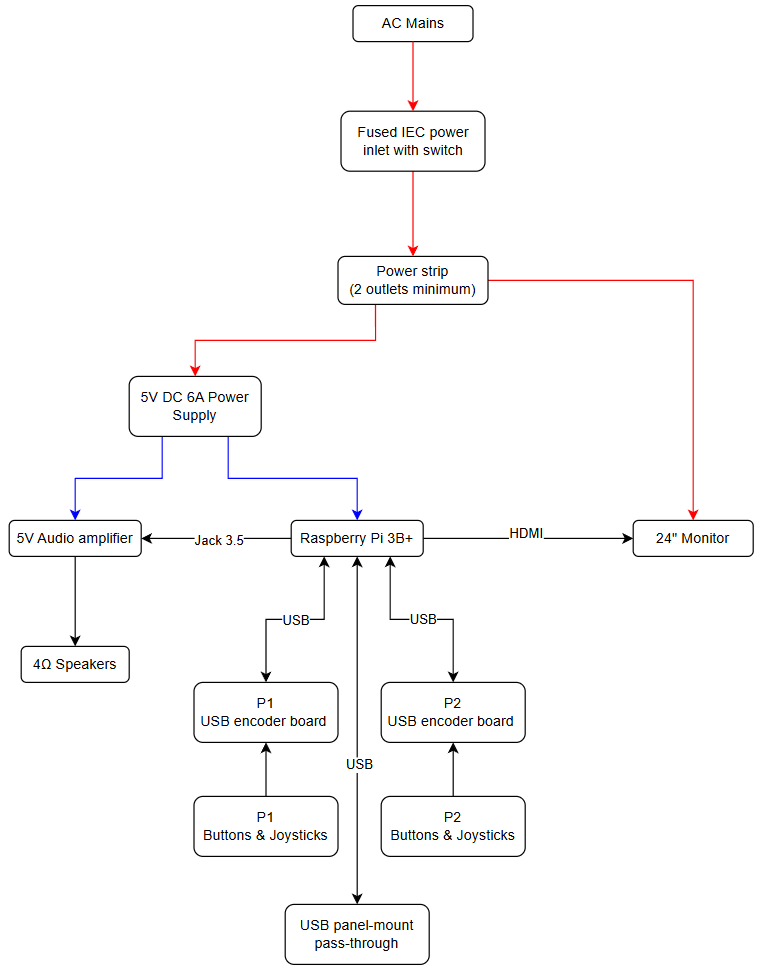

- **Mains**: the IEC inlet (switch + fuse) feeds an internal power strip, which powers the **monitor** and the **5 V power supply**.
- **5 V**: the 5 V power supply feeds the **Raspberry Pi** and the **audio amplifier**. The 6 A rating avoids undervoltage warnings caused by the LED buttons.
- **Signals**:
  - HDMI to the monitor;
  - 3.5 mm jack to the amplifier, then to the speakers;
  - USB to the 2 encoder boards and to the front panel pass-through.

> **Safety**: part of the wiring is **230 V mains**. If you are not comfortable working with mains voltage, get help. Insulate all connections carefully and always unplug the cabinet before working inside.

---

## Controls

### Front panel

| Control | Function |
| :--- | :--- |
| **1P / 2P** | Start a game for player 1 or 2. |
| **Coin (×2)** | Insert a coin (credit). |
| **1P + 2P pressed together** | *Hotkey* (access to Recalbox menus and shortcuts). This is the original cabinet's setting and can be changed. |
| **Center USB port** | USB pass-through, see below. |
| **Button under the marquee** | Volume (amplifier potentiometer). |

> The exact role of each button depends on **your Recalbox configuration**.

### Front USB port

This port lets you plug in:
- a **keyboard**, handy for navigating menus or debugging Recalbox;
- a **USB gamepad**, for games that need other types of controls, or to play **with 3 players** (2 on the cabinet + 1 on the gamepad);
- a **USB drive** or external disk.

---

## Software: Recalbox

The cabinet runs [Recalbox](https://www.recalbox.com/) **with no customization**. Everything is already very well documented by the Recalbox team, so **please refer to their [official tutorials](https://wiki.recalbox.com/en/tutorials)**.

In short:

1. **Installation**: flash Recalbox onto the microSD card with [Raspberry Pi Imager](https://www.raspberrypi.com/software/). Recalbox is listed directly among the available operating systems.
2. **Controls**: the kit's USB encoders are **recognized automatically**. Just assign the buttons using the standard Recalbox controller configuration procedure.
3. **Hotkey**: set it during controller configuration, for example 1P + 2P as on the original cabinet.

---

## Adding Games

The cleanest method is to **transfer games over the network**: with the cabinet connected via Wi-Fi or Ethernet, it shows up as a shared folder on your computer (`\\RECALBOX\share` on Windows). Just copy the ROMs into the folder of the matching system.

The procedure is explained, with screenshots, in the [official Recalbox tutorials](https://wiki.recalbox.com/en/tutorials).

### Where to find games?

The ROMs used on the original cabinet come from [archive.org](https://archive.org/).

> **Arcade games (MAME / FBNeo)**: each emulator expects a **specific romset version**. A game that won't launch almost always comes from an incompatible version. Check the [Recalbox tutorials](https://wiki.recalbox.com/en/tutorials) to find out which version is expected.
>
> The original cabinet is mainly used with **MAME**, but the other systems (consoles) that were tested also work.

> **Disclaimer**: **no ROMs are provided** in this repository. It is your responsibility to make sure you have the right to use the games you download, according to the laws of your country. The author of this project accepts no responsibility for how they are used.

---

## Coming Soon

- [ ] **Stand**: a stand will let you place the cabinet on the floor. The bartop part will remain **removable** and will attach to the stand with **toggle latches**. The current bartop is already compatible.

---

## License

This project is released under the **[Creative Commons BY-NC 4.0](LICENSE)** license.

**You can**:
- build the cabinet for yourself or as a gift;
- modify the files for your own use;
- share your remixes with attribution to the author.

**You cannot, without written agreement**:
- sell the files;
- sell kits, cut or printed parts, or assembled cabinets based on this design;
- make any other commercial use of it.

**Commercial licensing, kit manufacturing or partnerships**: Antoine Navarro EI (CeleauTech), [celeautech.contact@gmail.com](mailto:celeautech.contact@gmail.com)

---

  Designed and built by <b>CeleauTech</b> 
  If you like this project, feel free to leave a star on the repository and share your build!

